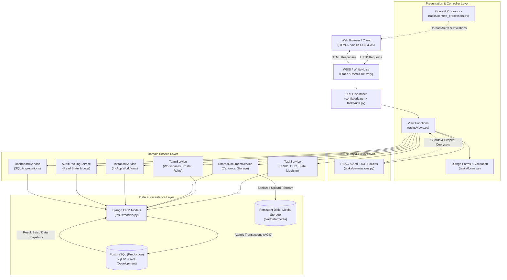
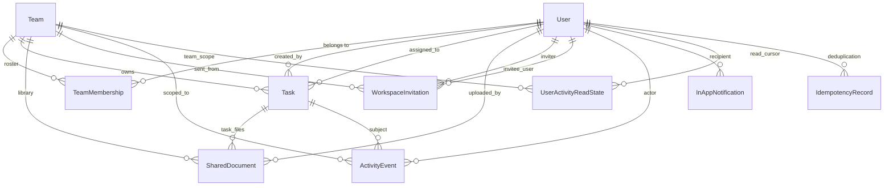
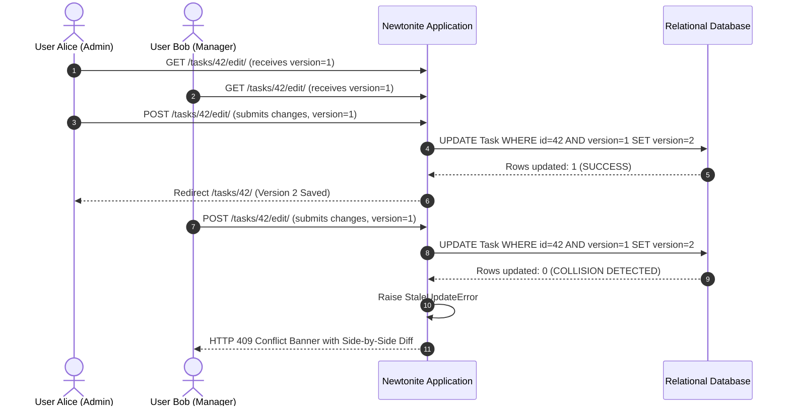
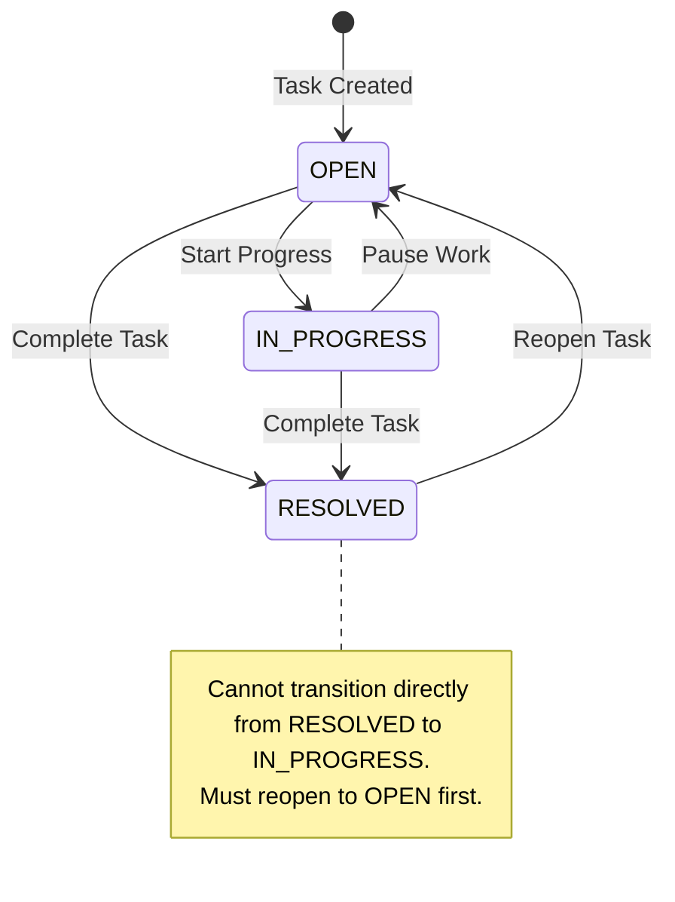
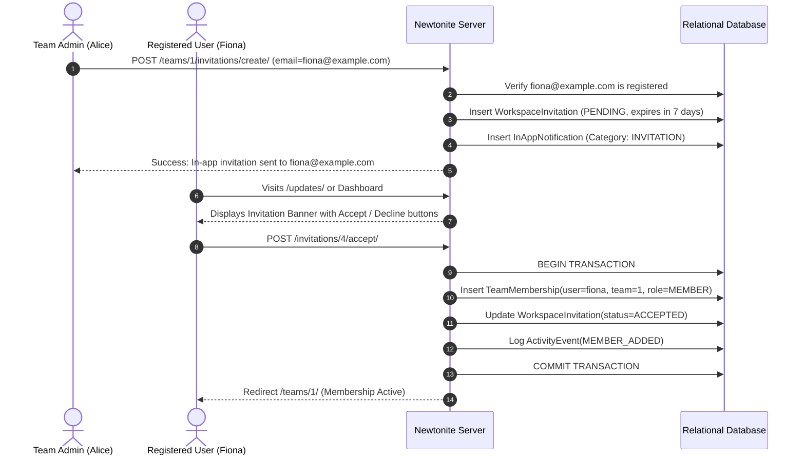

# Newtonite Task Tracker 🌿

> **Production-Grade, Multi-Tenant Operations Work-Item Management Platform**  
> Engineered with Python & Django for the **Newtonite Software Engineering Challenge: "Operations Under Pressure"**.

[](https://python.org)
[](https://djangoproject.com)
[](#2-system-architecture--design-patterns)
[-285741?style=for-the-badge&logo=pytest&logoColor=white)](#8-testing-strategy--verification-results)
[](#8-testing-strategy--verification-results)
[](#10-render-production-deployment-guide)
[](.github/workflows/test.yml)

---
## 🚀 Live Demo

**Live Application:** [Open Newtonite Task Tracker](http://13.61.21.114/login/)    || http://13.61.21.114/login/

**Demo Credentials**
- **Username:** `alice`
- **Password:** `Password123!`
- **Role:** Team Admin

## Executive Summary

**Newtonite Task Tracker** is an enterprise-ready, collaborative task and operations management platform designed to excel under real-world operational pressure: high concurrency, multi-user race conditions, network dropouts, multi-tenant security boundaries, and stringent compliance auditing.

The system is built as a **Modular Django Monolith** with strict domain service separation, scoped role-based access control (RBAC), multi-user optimistic concurrency control (OCC), idempotent request handling, in-app invitation workflows, canonical unified document storage, and an immutable audit trail with field-level JSON state diffs.

---

## Table of Contents

1. [Key Features & Critical Behaviors](#1-key-features--critical-behaviors)
2. [System Architecture & Design Patterns](#2-system-architecture--design-patterns)
3. [Database Architecture & Model Inventory](#3-database-architecture--model-inventory)
4. [Authentication, Authorization & Anti-IDOR Security](#4-authentication-authorization--anti-idor-security)
5. [Core Workflows & Business Rules](#5-core-workflows--business-rules)
6. [Design System & Frontend Architecture](#6-design-system--frontend-architecture)
7. [Quick Start & Local Setup Guide](#7-quick-start--local-setup-guide)
8. [Demonstration Accounts & Evaluator Credentials](#8-demonstration-accounts--evaluator-credentials)
9. [Testing Strategy & Verification Results](#9-testing-strategy--verification-results)
10. [Render Production Deployment Guide](#10-render-production-deployment-guide)
11. [Architecture Decision Records (ADRs)](#11-architecture-decision-records-adrs)
12. [Known Limitations & Production Roadmap](#12-known-limitations--production-roadmap)
13. [Project Directory & File Inventory](#13-project-directory--file-inventory)

---

## 1. Key Features & Critical Behaviors

Newtonite Task Tracker satisfies every requirement of the **Operations Under Pressure** challenge and implements ten distinct critical behaviors beyond standard CRUD operations:

```
┌─────────────────────────────────────────────────────────────────────────────┐
│                       NEWTONITE CORE PLATFORM PILLARS                       │
├──────────────────────┬──────────────────────┬───────────────────────────────┤
│ 🛡️ Concurrency & OCC │ 📁 Canonical Storage │ 👥 Multi-Tenant Workspaces    │
│ Atomic version check │ Single physical file │ Scoped team boundaries & RBAC │
│ Side-by-side diffs   │ Zero duplicate rows  │ Strict Anti-IDOR querysets    │
├──────────────────────┼──────────────────────┼───────────────────────────────┤
│ 🔁 Request Dedup     │ 💌 In-App Only Invites│ 📜 Immutable Audit Trails    │
│ Client UUID tokens   │ 100% internal alerts │ Structured JSON state diffs   │
│ Safe retried POSTs   │ Zero email leaks     │ Filter-safe read cursor (dot) │
├──────────────────────┼──────────────────────┼───────────────────────────────┤
│ 🚦 State Machine     │ ⏰ Deadline Monitor  │ 📊 Analytics Dashboard        │
│ Server-enforced flow │ Auto overdue scan    │ 6 KPI summary widgets         │
│ Atomic status locks  │ 24h deduplication    │ 4 real-time Chart.js graphs   │
└──────────────────────┴──────────────────────┴───────────────────────────────┘
```

### Detailed Capability Matrix

* **Multi-Tenant Workspace Governance**: Isolated organizational workspaces (`Team`) with distinct membership roles (`ADMIN`, `MANAGER`, `MEMBER`).
* **Optimistic Concurrency Control (OCC)**: Field-level version tracking via `Task.version` with atomic conditional SQL updates (`version = F('version') + 1`). Prevents silent lost updates; renders side-by-side diff conflict resolution banners on collision.
* **Idempotency Token Protection**: Unique client UUID token architecture preventing duplicate task creation when users double-click submit or network connections retry.
* **Canonical Unified Document Storage**: All uploads—from task creation, task detail, or the team shared library—generate exactly one canonical `SharedDocument` database record and one physical stored file. Backward compatibility with legacy `TaskAttachment` records is fully preserved.
* **In-App Only Team Invitations**: Completely self-contained within Newtonite. Zero outbound email delivery to prevent data leakage. Requires registered user verification with honest validation, instant in-app alerts, atomic POST-based accept/decline, role provisioning, and duplicate/expiry guards.
* **Filter-Safe Audit Read Tracking**: Persistent unread red dot indicator on the Activity navigation item powered by a per-user read cursor (`UserActivityReadState`). Scoped strictly to accessible teams; protected against premature clearing on filtered views or subsequent pagination pages.
* **Server-Enforced Task Lifecycle State Machine**: Robust backend transition validator enforcing strict progression (`OPEN` $\leftrightarrow$ `IN_PROGRESS` $\rightarrow$ `RESOLVED` $\rightarrow$ `OPEN`). Disallows bypassing directly to resolved on creation.
* **Anti-IDOR Security & Queryset Scoping**: All database queries are filtered via `get_accessible_tasks_qs()` and `get_accessible_teams_qs()`. Direct object access is verified by resource-level permission checks raising HTTP 403 Forbidden on violation.
* **Anti-Privilege Escalation & Invariant Protection**: The last administrator of a team cannot be demoted or removed. Assignees must be active members of the task's team. When a member is removed from a team, assigned tasks safely transition to unassigned without data loss.
* **Automated Deadline Alert Scanner**: Background scanner detecting overdue tasks and tasks due today, dispatching in-app notifications with 24-hour rate-limiting to prevent alert fatigue.
* **Interactive Analytics & Reporting**: Real-time operational dashboard with 6 KPI cards and 4 Chart.js visualizations (Status Doughnut, Priority Breakdown, 7-Day Velocity Trend Line, and Team Workload Distribution).

---

## 2. System Architecture & Design Patterns

The application follows the **Modular Django Monolith** architectural style, decoupling business logic and access control from the view/template layer.



### Architectural Responsibilities

| Layer | Component | Responsibility |
| :--- | :--- | :--- |
| **Presentation** | `tasks/views.py` | Handles HTTP request unwrapping, Post-Redirect-Get (PRG) redirects, template rendering, and error status mapping (403, 404, 409). |
| **Validation** | `tasks/forms.py` | Validates payloads, sanitizes inputs, injects UUID idempotency tokens, and binds OCC version numbers. |
| **Security & Policy** | `tasks/permissions.py` | Pure functional authorization layer. Evaluates resource-level RBAC rules and constructs tenant-scoped querysets to prevent IDOR leaks. |
| **Domain Services** | `tasks/services.py` | Encapsulates all transactional business logic, state machines, atomic version increments, audit logging, and service orchestration. |
| **Persistence** | `tasks/models.py` | Defines normalized relational models, composite indexes, model-level validation invariants (`clean()`), and foreign key cascade rules. |
| **Asset Delivery** | `WhiteNoise` | Production static asset pipeline with sha256 hash fingerprinting and gzip/brotli pre-compression. |

---

## 3. Database Architecture & Model Inventory

Newtonite Task Tracker uses a clean relational schema engineered for high query efficiency, data integrity, and strict tenant isolation.

### Entity Relationship Model



### Model Specifications

#### 1. `Team` (Workspace Boundary)
* Primary organizational container. All work items, documents, and audit logs are scoped to a team.
* **Fields**: `id` (BigAutoField), `name` (CharField, unique), `description` (TextField), `created_at`, `updated_at`.
* **Methods**: `member_count()`, `active_tasks_count()`, `open_tasks_count()`, `overdue_tasks_count()`.

#### 2. `TeamMembership` (User Role Association)
* Maps users to teams with explicit permission roles.
* **Fields**: `user` (FK $\rightarrow$ User), `team` (FK $\rightarrow$ Team), `role` (`ADMIN`, `MANAGER`, `MEMBER`), `created_at`.
* **Constraint**: `UniqueConstraint(fields=['user', 'team'], name='unique_user_team_membership')`.

#### 3. `Task` (Core Work Item)
* Work item with optimistic concurrency, workflow state machine, and assignee invariants.
* **Fields**: `title`, `description`, `status` (`OPEN`, `IN_PROGRESS`, `RESOLVED`), `priority` (`LOW`, `MEDIUM`, `HIGH`, `URGENT`), `team` (FK), `assignee` (FK $\rightarrow$ User, null=True), `creator` (FK $\rightarrow$ User), `due_date`, `is_archived`, `archived_at`, `version` (PositiveIntegerField, default=1), `created_at`, `updated_at`.
* **Invariants (`clean()`)**: The assignee must be an active member of `task.team`.
* **Composite Indexes**:
  * `(team, is_archived, status)`
  * `(team, is_archived, priority)`
  * `(assignee, is_archived, status)`
  * `(due_date)`, `(created_at)`

#### 4. `SharedDocument` (Canonical Unified Document Storage)
* Single canonical record representing all document uploads (task-associated or general workspace files).
* **Fields**: `team` (FK $\rightarrow$ Team), `task` (FK $\rightarrow$ Task, null=True), `uploader` (FK $\rightarrow$ User), `file` (FileField $\rightarrow$ `shared_documents/team_<id>/`), `filename` (CharField), `file_size` (PositiveIntegerField), `content_type` (CharField), `created_at`, `updated_at`.
* **Validation**: 25 MiB file size limit, dangerous extension blocking (`.exe`, `.bat`, `.sh`, `.py`, `.js`, etc.), path traversal sanitization.
* **Indexes**: `(team, created_at)`, `(task, created_at)`.

#### 5. `TaskAttachment` (Legacy Attachment Compatibility)
* Preserved intact for existing records. All new uploads route to `SharedDocument`.
* **Fields**: `task` (FK $\rightarrow$ Task), `uploader` (FK $\rightarrow$ User), `file`, `filename`, `file_size`, `content_type`, `created_at`.

#### 6. `WorkspaceInvitation` (In-App Team Invitations)
* Database-backed in-app invitation for registered users.
* **Fields**: `team` (FK $\rightarrow$ Team), `inviter` (FK $\rightarrow$ User), `invitee_email` (EmailField), `invitee_user` (FK $\rightarrow$ User, null=True), `role` (CharField), `status` (`PENDING`, `ACCEPTED`, `DECLINED`, `REVOKED`, `EXPIRED`), `created_at`, `expires_at` (Default: 7 days).
* **Index**: `(team, status, invitee_email)`.

#### 7. `InAppNotification` (Real-Time In-App Alert Feed)
* User alert notifications for assignments, deadlines, invitations, and status changes.
* **Fields**: `recipient` (FK $\rightarrow$ User), `actor` (FK $\rightarrow$ User, null=True), `category` (`ASSIGNMENT`, `DEADLINE`, `STATUS`, `INVITATION`, `GENERAL`), `title`, `message`, `task` (FK), `invitation` (FK), `team` (FK), `is_read`, `read_at`, `is_urgent`, `created_at`.
* **Indexes**: `(recipient, is_read, created_at)`, `(recipient, category)`.

#### 8. `UserActivityReadState` (Audit Read Cursor Tracking)
* Stores the highest `ActivityEvent.id` viewed by a user for each accessible team.
* **Fields**: `user` (FK $\rightarrow$ User), `team` (FK $\rightarrow$ Team), `last_read_event_id` (PositiveBigIntegerField, default=0), `updated_at`.
* **Constraint**: `UniqueConstraint(fields=['user', 'team'], name='unique_user_team_read_state')`.

#### 9. `ActivityEvent` (Immutable Audit Log)
* Structured audit event capturing field diffs across all entities.
* **Fields**: `actor` (FK $\rightarrow$ User), `team` (FK $\rightarrow$ Team), `task` (FK $\rightarrow$ Task, null=True), `event_type` (CharField), `details` (TextField), `previous_state` (JSONField), `new_state` (JSONField), `created_at`.
* **Indexes**: `(team, created_at)`, `(task, created_at)`, `(actor, created_at)`.

#### 10. `IdempotencyRecord` (Request Deduplication)
* Enforces deduplication of POST requests using a client-side UUID key.
* **Fields**: `key` (CharField, max_length=64), `user` (FK $\rightarrow$ User), `action` (CharField), `response_code` (IntegerField), `task` (FK $\rightarrow$ Task), `created_at`.
* **Constraint**: `UniqueConstraint(fields=['user', 'key', 'action'], name='unique_user_key_action_idempotency')`.

---

## 4. Authentication, Authorization & Anti-IDOR Security

Newtonite enforces server-side security at both the **Queryset Scoping** level and the **Object Permission** level.

### Scoped Role-Based Access Control (RBAC) Matrix

| Operational Capability | Superuser | Team Admin | Team Manager | Team Member | Non-Member |
| :--- | :---: | :---: | :---: | :---: | :---: |
| **View Workspace & Roster** | ✅ | ✅ | ✅ | ✅ | ❌ (403) |
| **Edit Team Settings** | ✅ | ✅ | ❌ (403) | ❌ (403) | ❌ (403) |
| **Invite Collaborators (In-App)** | ✅ | ✅ | ❌ (403) | ❌ (403) | ❌ (403) |
| **Change Member Roles** | ✅ | ✅ | ❌ (403) | ❌ (403) | ❌ (403) |
| **Remove Member (Safe Unlink)** | ✅ | ✅ | ❌ (403) | ❌ (403) | ❌ (403) |
| **Demote Sole Team Admin** | ❌ Blocked | ❌ Blocked | ❌ Blocked | ❌ Blocked | ❌ Blocked |
| **Create Work Item (Task)** | ✅ | ✅ | ✅ | ✅ | ❌ (403) |
| **Edit Any Team Task** | ✅ | ✅ | ✅ | ❌ Assigned/Created Only | ❌ (403) |
| **Execute Status Transitions** | ✅ | ✅ | ✅ | ✅ Assigned Only | ❌ (403) |
| **Archive / Restore Task** | ✅ | ✅ | ✅ | ❌ (403) | ❌ (403) |
| **Upload Shared Documents** | ✅ | ✅ | ✅ | ✅ | ❌ (403) |
| **Download Team Documents** | ✅ | ✅ | ✅ | ✅ | ❌ (403) |
| **Delete Any Document** | ✅ | ✅ | ✅ | ❌ Own Uploads Only | ❌ (403) |
| **View Audit Activity History** | ✅ | ✅ | ✅ | ✅ | ❌ (403) |

### Anti-IDOR Defense in Depth

1. **Queryset-Level Scoping**: Views never query global sets like `Task.objects.all()`. Instead, all lookups use:
   ```python
   # tasks/permissions.py
   def get_accessible_tasks_qs(user, include_archived=False):
       if is_system_admin(user):
           qs = Task.objects.all()
       else:
           qs = Task.objects.filter(team__memberships__user=user)
       if not include_archived:
           qs = qs.filter(is_archived=False)
       return qs
   ```
2. **Resource-Level Authorization Checks**: After retrieving any object by ID, explicit policy guards verify the actor's permissions before processing:
   ```python
   task = get_object_or_404(Task, pk=pk)
   if not can_edit_task(request.user, task):
       raise PermissionDenied("You do not have permission to edit this task.")
   ```
3. **Sole Admin Protection**: A team cannot have its last administrator removed or demoted, preventing orphaned workspaces.

---

## 5. Core Workflows & Business Rules

### Workflow A: Optimistic Concurrency Control (OCC)

When multiple users open and edit the same work item simultaneously, Newtonite eliminates silent data overwrites.



### Workflow B: Task Lifecycle State Machine

The server enforces strict state transitions. Tasks cannot be skipped directly to `RESOLVED` during creation, and resolved tasks must be reopened before continuing work.



### Workflow C: In-App Only Team Invitations



---

## 6. Design System & Frontend Architecture

The user interface is built with an editorial aesthetic inspired by modern, minimalist SaaS applications (Linear, Notion, Stripe), featuring warm natural tones, crisp typography, and fluid micro-interactions without relying on heavy frontend frameworks.

### Color Palette Tokens

```
Light Theme (Warm Ivory & Sage)           Dark Theme (Deep Forest Night)
┌───────────────────────────────────────┐ ┌───────────────────────────────────────┐
│ App Background:   #FDFBF7 (Warm Ivory)│ │ App Background:   #101713 (Charcoal)  │
│ Surface / Cards:  #FFFFFF (Crisp White│ │ Surface / Cards:  #18221C (Dark Slate) │
│ Primary Accent:   #285741 (Forest Grn)│ │ Primary Accent:   #386E53 (Forest Glo)│
│ Secondary Accent: #5C8571 (Sage Green)│ │ Accent Light:     #8EB3A2 (Muted Sage)│
│ Text Primary:     #202923 (Charcoal)  │ │ Text Primary:     #F0F2E9 (Off White) │
│ Border Subtle:    #E5E0D8 (Warm Gray) │ │ Border Subtle:    #24332A (Dark Border│
└───────────────────────────────────────┘ └───────────────────────────────────────┘
```

### Typography Hierarchy

* **Editorial Display Headings**: [*Newsreader*](https://fonts.google.com/specimen/Newsreader) (Serif optical sizing with italic emphasis).
* **Interface & Controls**: [*Plus Jakarta Sans*](https://fonts.google.com/specimen/Plus+Jakarta+Sans) (Geometric, legible UI copy).
* **Tabular Copy & Data**: [*Inter*](https://fonts.google.com/specimen/Inter) (High legibility for task tables, status chips, and metadata).
* **Code & Monospace**: [*JetBrains Mono*](https://fonts.google.com/specimen/JetBrains+Mono) (Version indicators, file sizes, and IDs).

### Custom Vector Artwork

* **Botanical Leaf Emblem** (`static/img/leaf_emblem.svg`): Vector twin-leaf emblem with delicate stems and veins, used in navigation headers, authentication screens, and error pages.
* **Architectural Hero Artwork** (`static/img/cityscape_art.svg`): Layered geometric pavilions, stepped terraces, and minimalist architectural towers rendered in matching sage and forest green palette.

---

## 7. Quick Start & Local Setup Guide

Follow these steps to set up and run the application locally on Windows (PowerShell), macOS, or Linux.

### Prerequisites

* **Python**: Version 3.11, 3.12, or 3.14 (Verified working on Python 3.14.3).
* **Git**: Installed and configured.

---

### Step 1: Clone Repository & Create Virtual Environment

```bash
# Clone the repository
git clone https://github.com/omeesha1234567/TaskWorkspace-Newtonite.git
cd TaskWorkspace-Newtonite

# Create virtual environment
python -m venv venv

# Activate virtual environment
# Windows (PowerShell):
.\venv\Scripts\Activate.ps1
# Windows (Command Prompt):
.\venv\Scripts\activate.bat
# macOS / Linux (bash/zsh):
source venv/bin/activate
```

> [!TIP]
> **Windows PowerShell Execution Policy Note**:
> If activating the virtual environment in PowerShell throws an `Execution_Policies` script restriction error, run:
> ```powershell
> Set-ExecutionPolicy -Scope Process -ExecutionPolicy RemoteSigned
> ```
> and then retry `.\venv\Scripts\Activate.ps1`.

---

### Step 2: Install Dependencies

```bash
pip install -r requirements.txt
```

Verify that all dependencies installed cleanly without conflicts:
```bash
pip check
```

---

### Step 3: Run System Verification & Database Migrations

```bash
# Verify system configuration
python manage.py check

# Apply schema migrations
python manage.py migrate
```

---

### Step 4: Understanding Static Assets (Development vs Production)

* **Local Development (`runserver`)**: Django automatically discovers and serves static files directly from `static/` (such as `static/css/`, `static/js/`, `static/img/`). You do **not** need to copy or compile assets manually for local development.
* **Production Build / Deployment (`collectstatic`)**: When preparing for production or deploying to platforms like Render, run:
  ```bash
  python manage.py collectstatic --no-input
  ```
  This command compiles all assets from `static/` into `STATIC_ROOT` (`staticfiles/`) and generates the immutable hashed manifest (`staticfiles.json`) used by WhiteNoise's `CompressedManifestStaticFilesStorage`.

---

### Step 5: Execute Automated Test Suite

The test suite runs against a dedicated test settings module (`config/test_settings.py`) using standard static storage, requiring zero pre-compiled build artifacts:

```bash
# Run via native Django test runner (75 passing tests, 0 warnings)
python manage.py test

# Or run via Pytest with verbose reporting
python -m pytest -v

# Or run with test coverage report
python -m pytest --cov=tasks --cov-report=term
```

---

### Step 6: Seed Showcase Demo Data (Optional)

The seeding script populates realistic, database-backed demonstration records (8 users across 4 teams, work items with different priorities/statuses, in-app notifications, and shared documents). It is verifiably idempotent and safe to execute repeatedly:

```bash
python manage.py seed_demo_data
```

> [!NOTE]
> All demonstration users are intended strictly for local development and testing evaluation.

---

### Step 7: Start Local Development Server

```bash
python manage.py runserver 127.0.0.1:8000
```

Open your browser and navigate to: **[http://127.0.0.1:8000/](http://127.0.0.1:8000/)**

---

### Troubleshooting Common Setup Issues

| Issue / Symptom | Underlying Cause | Quick Resolution |
| :--- | :--- | :--- |
| `Activate.ps1 cannot be loaded because running scripts is disabled` | PowerShell default execution policy blocks unsigned local scripts. | Run `Set-ExecutionPolicy -Scope Process -ExecutionPolicy RemoteSigned` in your current PowerShell session. |
| `Error: That port is already in use` | Another process is bound to port 8000. | Start on an alternate port: `python manage.py runserver 8080`. |
| `Missing staticfiles manifest entry` during tests | Test runner ran against production manifest storage instead of test storage. | Ensure `manage.py test` or `pytest -v` is run directly; `config/test_settings.py` automatically uses `StaticFilesStorage` for tests. |
| `No broken requirements found` check fails on Windows | Timezone database is missing. | `requirements.txt` includes `tzdata>=2024.1` providing IANA time zone support for `Asia/Kolkata` on Windows systems. |

---

## 8. Demonstration Accounts & Evaluator Credentials

All standard demonstration accounts share the password: `Password123!`  
The system administrator superuser shares the password: `AdminPass123!`

| Username | Role | Assigned Teams | Operational Testing Focus |
| :--- | :--- | :--- | :--- |
| **`alice`** | **Team Admin** | Core Platform Engineering | Workspace settings, member management, task creation, in-app invitations, shared document management. |
| **`bob`** | **Team Manager** | Core Platform (Manager), Frontend (Member) | Multi-team management, task assignments, status transitions, shared library uploads. |
| **`charlie`** | **Team Member** | Core Platform (Member), Mobile Apps (Admin) | Contributor workflows; editing assigned tasks; deleting own uploaded documents. |
| **`diana`** | **Team Admin** | Frontend Engineering | Design lead; creating frontend deliverables; sending team invitations. |
| **`edward`** | **Team Manager** | Frontend Engineering | Reviewing UI deliverables; managing team task transitions. |
| **`fiona`** | **Team Member / Invitee** | Core Platform (Member), Pending invite to Frontend | Testing in-app invitation acceptance and multi-team collaboration. |
| **`george`** | **Isolated Member** | Operations Support | Testing team data isolation, anti-IDOR boundaries, and permission barriers. |
| **`admin`** | **System Superuser** | Organization-wide | Django Admin portal at `/admin/`, organization-wide override. |

---

## 9. Testing Strategy & Verification Results

The automated test suite verifies all critical behaviors, multi-tenant boundaries, race conditions, file upload security, task creation, assignee validation, brand asset delivery, and Indian Standard Time (IST) deadlines.

```
Total Test Cases:   75 Automated Tests
Test Pass Rate:     100% Passed (0 Failures, 0 Errors, 0 Warnings)
Execution Time:     ~1.5 seconds (via MD5 fast test password hasher)
Code Coverage:      74% across tasks app (100% on models, admin, urls, context_processors)
CI Pipeline:        GitHub Actions (.github/workflows/test.yml)
```

### Test Suite Catalog Breakdown

```
tasks/tests.py (75 Tests)
├── AuthenticationAndSecurityTests (4 tests)
│   ├── test_unauthenticated_user_redirected_to_login
│   ├── test_login_success_and_session
│   ├── test_login_invalid_credentials_does_not_leak_user_existence
│   └── test_registration_creates_user_and_default_workspace
├── TeamAuthorizationAndIsolationTests (3 tests)
│   ├── test_cross_team_data_isolation (Anti-IDOR)
│   ├── test_team_membership_uniqueness_constraint
│   └── test_assignee_must_belong_to_team
├── TaskCRUDAndValidationTests (3 tests)
│   ├── test_create_task_lifecycle_and_audit
│   ├── test_new_task_cannot_start_in_resolved_status
│   └── test_member_permission_boundaries
├── WorkflowTransitionTests (2 tests)
│   ├── test_valid_status_flow (OPEN -> IN_PROGRESS -> RESOLVED -> OPEN)
│   └── test_invalid_status_transition_rejected
├── OptimisticConcurrencyStaleUpdateTests (1 test)
│   └── test_stale_update_protection_raises_error (OCC 409 Conflict)
├── IdempotencyDuplicateSubmissionTests (1 test)
│   └── test_idempotent_task_creation_prevents_duplicate
├── RoleEscalationAndMembershipTests (2 tests)
│   ├── test_prevent_demoting_sole_admin
│   └── test_member_cannot_manage_team_or_add_members
├── DashboardMetricsTests (1 test)
│   └── test_dashboard_aggregates_correctly
├── TaskAttachmentTests (4 tests)
│   ├── test_authorized_user_can_upload_attachment
│   ├── test_unauthorized_user_cannot_upload_attachment
│   ├── test_file_download_authorization
│   └── test_delete_attachment_cleans_up_storage
├── WorkspaceInvitationTests (8 tests)
│   ├── test_admin_can_create_invitation
│   ├── test_non_admin_cannot_create_invitation
│   ├── test_duplicate_pending_invitation_prevention
│   ├── test_invitee_can_accept_invitation
│   ├── test_unauthorized_user_cannot_accept_someone_elses_invitation
│   ├── test_invitee_can_decline_invitation
│   ├── test_admin_can_revoke_invitation
│   └── test_unregistered_email_cannot_receive_invitation
├── InAppNotificationTests (3 tests)
│   ├── test_notification_created_on_task_assignment
│   ├── test_mark_as_read_and_mark_all_read
│   └── test_updates_center_view_renders_successfully
├── FeatureWorkflowIntegrationTests (5 tests)
│   ├── test_dashboard_displays_pending_invitation_banner
│   ├── test_task_creation_with_multiple_attachments
│   ├── test_notification_mark_read_view
│   ├── test_notification_mark_all_read_view
│   └── test_invitation_accept_flow_via_post
├── SharedDocumentValidationAndModelTests (6 tests)
│   ├── test_upload_general_document_success
│   ├── test_upload_task_specific_document_success
│   ├── test_oversized_file_rejected (> 25 MiB)
│   ├── test_executable_and_dangerous_files_rejected (.exe, .sh, .bat)
│   ├── test_empty_file_rejected (0-byte file)
│   └── test_cross_team_task_association_rejected
├── SharedDocumentPermissionsAndSecurityTests (7 tests)
│   ├── test_anonymous_user_cannot_access_or_download
│   ├── test_non_team_member_cannot_view_or_download (403)
│   ├── test_team_member_can_view_and_download
│   ├── test_member_can_delete_own_document
│   ├── test_member_cannot_delete_another_users_document (403)
│   ├── test_manager_and_admin_can_delete_any_team_document
│   └── test_document_search_is_team_isolated
├── TeamInvitationWorkflowVerificationTests (4 tests)
│   ├── test_invitation_creation_is_in_app_only_and_sends_no_email
│   ├── test_accept_invitation_creates_membership_atomically
│   ├── test_decline_invitation_does_not_create_membership
│   └── test_unauthorized_user_cannot_accept_another_invitation
├── AuditReadIndicatorTrackingTests (1 test)
│   └── test_audit_indicator_lifecycle_and_isolation
├── SharedDocumentViewAndEndpointIntegrationTests (6 tests)
│   ├── test_documents_index_view_redirects_to_first_team
│   ├── test_upload_view_via_post_success
│   ├── test_delete_view_post_forbidden_for_non_member
│   ├── test_invitation_cannot_be_accepted_twice
│   ├── test_expired_invitation_cannot_be_accepted
│   └── test_revoked_invitation_cannot_be_accepted
├── StaticFilesAndBrandAssetsRegressionTests (5 tests)
│   ├── test_brand_leaf_emblem_static_url_resolves
│   ├── test_cityscape_art_static_url_resolves
│   ├── test_base_template_renders_static_assets_safely
│   ├── test_auth_pages_render_with_static_brand_emblem
│   └── test_production_compressed_manifest_storage_workflow
├── TaskCreationAndAssigneeRegressionTests (6 tests)
│   ├── test_task_create_form_populates_assignee_for_submitted_team
│   ├── test_task_create_form_rejects_cross_team_assignee
│   ├── test_task_creation_end_to_end_via_post
│   ├── test_task_creation_unassigned_success
│   ├── test_task_edit_change_assignee_dispatches_notification_and_audit
│   └── test_api_team_members_returns_members_and_enforces_auth
└── IndianStandardTimeAndDeadlineTests (3 tests)
    ├── test_configured_timezone_is_asia_kolkata
    ├── test_timezone_active_is_asia_kolkata
    └── test_indian_calendar_date_near_utc_midnight
```

---

## 10. Render Production Deployment Guide

The application is fully pre-configured for automated continuous deployment on [Render](https://render.com) using Infrastructure-as-Code.

### Infrastructure Blueprint (`render.yaml`)

```yaml
services:
  - type: web
    name: newtonite-web
    env: python
    plan: starter
    buildCommand: "./build.sh"
    startCommand: "gunicorn config.wsgi:application"
    disk:
      name: media-data
      mountPath: /var/data/media
      sizeGB: 1
    envVars:
      - key: DATABASE_URL
        fromDatabase:
          name: newtonite-postgres
          property: connectionString
      - key: SECRET_KEY
        generateValue: true
      - key: DEBUG
        value: "False"
      - key: ALLOWED_HOSTS
        value: ".onrender.com"
      - key: CSRF_TRUSTED_ORIGINS
        value: "https://*.onrender.com"
      - key: MEDIA_ROOT
        value: "/var/data/media"

databases:
  - name: newtonite-postgres
    plan: free
```

### Build & Run Pipeline

* **Build Script (`build.sh`)**:
  ```bash
  pip install -r requirements.txt
  python manage.py collectstatic --no-input
  python manage.py migrate
  ```
* **Production Static Serving**: Handled efficiently by WhiteNoise with compressed manifest cache busting.
* **Database Driver**: Configured via `dj-database-url` and `psycopg2-binary`. Falls back automatically to SQLite if `DATABASE_URL` is unset.

> [!IMPORTANT]
> **Ephemeral Filesystems vs Persistent Disk**:
> Render's free tier provides an ephemeral filesystem where disk changes are wiped on restarts. To ensure shared documents and attachments persist durably, `render.yaml` specifies a **Starter web service** with a 1GB persistent disk mounted at `/var/data/media`.
>
> **Database Distinction**:
> Local SQLite data (`db.sqlite3`) does not transfer to Render PostgreSQL. To populate realistic demonstration records on Render, execute `python manage.py seed_demo_data` via Render's SSH/Shell console.

---

## 11. Architecture Decision Records (ADRs)

| ADR | Decision | Context & Trade-off Rationale |
| :--- | :--- | :--- |
| **ADR 1** | **Modular Django Monolith over SPA** | Chosen for rapid development, built-in security (CSRF, session auth), robust ORM transactions, and zero build toolchain overhead. Eliminates API version skew. |
| **ADR 2** | **Optimistic Concurrency Control (OCC) over Pessimistic Row Locking** | Long think-times during task editing make database row locks (`SELECT FOR UPDATE`) prone to deadlocks and connection exhaustion. OCC via `Task.version` offers non-blocking reads and safe conflict alerts. |
| **ADR 3** | **Idempotency Token Architecture** | Eliminates duplicate task creation on network retries or double-clicks without modifying global database constraints. |
| **ADR 4** | **Queryset-Level Scoping for Multi-Tenancy** | Filters all database access through tenant-scoped functions (`get_accessible_tasks_qs`), guaranteeing that bugs in view logic cannot leak data across teams. |
| **ADR 5** | **Soft Archiving with Hard Data Integrity** | Tasks are soft-archived via `is_archived=True` to preserve historical audit logs and relational foreign keys, while excluding inactive items from active dashboards. |
| **ADR 6** | **In-App Only Team Invitations** | Outbound email delivery in production invites external failure modes (bounces, spam filters, SMTP outages) and leaks confidential collaborator addresses. In-app alerts provide instant, atomic, and audited team onboarding. |
| **ADR 7** | **Unified Canonical Document Storage** | Merges task attachments and shared documents into a single canonical `SharedDocument` model. Guarantees single-file storage, consistent security checks, and physical disk unlinking on deletion. |
| **ADR 8** | **Per-User Database Read Cursor for Audit Tracking** | Avoids expensive boolean flags per user/event. Stores a single `last_read_event_id` per user and team in `UserActivityReadState`, querying unread presence with high-performance `.exists()`. |
| **ADR 9** | **Render Persistent Disk Storage Architecture** | Containers on cloud PaaS are ephemeral. Mounting a 1GB persistent disk at `/var/data/media` guarantees durability for user-uploaded documents across restarts. |

---

## 12. Known Limitations & Production Roadmap

* **Database Scalability**: Local development uses SQLite 3, which serializes writes. Under extreme write concurrency, SQLite may encounter database locks. The application is fully prepared for PostgreSQL via `DATABASE_URL`.
* **Real-Time Push**: Updates currently rely on standard HTTP navigation and fast page loads. High-frequency live collaborative editing could be enhanced with Django Channels / WebSockets.
* **Background Worker Processing**: Automated overdue scanning runs synchronously during dashboard requests (with 24-hour deduplication). For larger organizations, this can be moved to Celery or Django Q with a Redis broker.

---

## 13. Project Directory & File Inventory

```
.
├── DATABASE_ENGINEERING.md       # Schema design, indexes, ACID invariants & OCC concurrency
├── ENGINEERING_DECISIONS.md      # Full Architecture Decision Records (ADRs 1 through 9)
├── KNOWN_LIMITATIONS.md          # Architectural trade-offs, storage guarantees & roadmap
├── LICENSE                       # Project license (Apache 2.0 / GNU compatible)
├── PERMISSIONS.md                # Scoped RBAC permissions matrix and security invariants
├── PROJECT_ARCHITECTURE.md       # High-level architecture, request flows & Mermaid diagrams
├── PROJECT_CONTEXT.txt           # Authoritative living technical context file
├── README.md                     # [THIS FILE] Primary assessment documentation & runbook
├── TESTING.md                    # Testing philosophy, test catalog & coverage reports
├── build.sh                      # Render automated deployment build script
├── render.yaml                   # Render Blueprint Infrastructure-as-Code manifest
├── requirements.txt              # Production and testing runtime dependencies
├── pytest.ini                    # Pytest configuration with django settings integration
├── db.sqlite3                    # Local SQLite 3 database with seeded showcase data
├── manage.py                     # Django management CLI entry point
│
├── .github/
│   └── workflows/
│       └── test.yml              # GitHub Actions Continuous Integration pipeline
│
├── config/                       # Project configuration package
│   ├── asgi.py                   # ASGI application callable
│   ├── settings.py               # Django settings (WhiteNoise, dj-database-url, RBAC)
│   ├── test_settings.py          # Dedicated automated test configuration (StaticFilesStorage)
│   ├── urls.py                   # Root URL dispatcher
│   └── wsgi.py                   # WSGI application callable
│
├── media/                        # User-uploaded files (Persistent Disk mount target)
│   ├── attachments/              # Legacy task attachments storage
│   └── shared_documents/         # Canonical unified document storage partitioned by team
│
├── static/                       # Static web assets
│   ├── css/
│   │   └── app.css               # Vanilla CSS design system (tokens, themes, components)
│   ├── js/
│   │   └── app.js                # Vanilla JS (theme switch, form locks, dropzone)
│   └── img/
│       ├── leaf_emblem.svg       # Botanical leaf brand vector emblem
│       └── cityscape_art.svg     # Architectural isometric hero illustration
│
├── tasks/                        # Core application package
│   ├── admin.py                  # Django administrative model registrations
│   ├── apps.py                   # AppConfig for 'tasks' app
│   ├── context_processors.py     # Global template context (unread audit & notifications)
│   ├── forms.py                  # Django ModelForms (OCC version binding, idempotency keys)
│   ├── models.py                 # Domain models (Team, Task, SharedDocument, etc.)
│   ├── permissions.py            # RBAC authorization guards and anti-IDOR queryset helpers
│   ├── services.py               # Domain services (TaskService, SharedDocumentService, etc.)
│   ├── tests.py                  # Automated test suite (75 tests, 100% pass rate)
│   ├── urls.py                   # Application URL patterns (35+ named routes)
│   ├── views.py                  # View controllers (PRG redirects, conflict resolution)
│   ├── management/
│   │   └── commands/
│   │       └── seed_demo_data.py # Idempotent showcase data seeder CLI
│   └── migrations/
│       ├── 0001_initial.py
│       ├── 0002_taskattachment_workspaceinvitation_inappnotification.py
│       └── 0003_alter_activityevent_event_type_useractivityreadstate_and_more.py
│
└── templates/                    # Server-rendered HTML5 templates
    ├── base.html                 # Master layout (sidebar, topbar, theme switcher, alerts)
    ├── 403.html                  # Custom HTTP 403 Forbidden template
    ├── 404.html                  # Custom HTTP 404 Not Found template
    ├── 500.html                  # Custom HTTP 500 Server Error template
    ├── activity/
    │   └── list.html             # Audit activity history log with filters
    ├── auth/                     # Authentication templates (login, register, reset)
    ├── dashboard/
    │   └── index.html            # Operational dashboard (KPIs, Chart.js, hero artwork)
    ├── documents/
    │   └── team_library.html     # Team shared document library UI
    ├── profile/
    │   └── index.html            # User profile and workspace affiliations
    ├── tasks/                    # Task CRUD templates (create, detail, edit, list)
    ├── teams/                    # Team workspace templates (create, detail, edit, list)
    └── updates/
        └── index.html            # In-app updates center (deadline alerts, notifications)
```

---

<p align="center">
  <b>Newtonite Task Tracker</b> — Crafted for the <i>Newtonite Software Engineering Challenge: Operations Under Pressure</i>.
</p>
